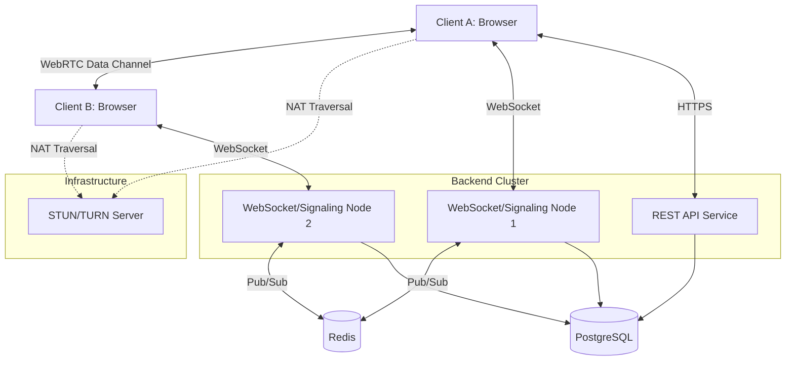
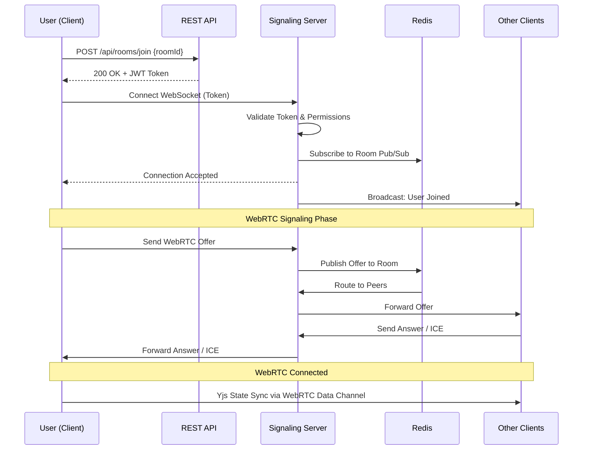

# Project Specification: Collaborative Code Editor

> [!NOTE]
> **Project Vision**
> A real-time, multi-user collaborative code editor (similar to VS Code Live Share) designed for mid-sized development teams. The platform emphasizes low-latency document synchronization, robust presence indicators, and seamless team communication.

---

## 1. Role and Context

### Target Audience
- Mid-sized software development teams (6–12 engineers).
- Primary use cases: pair programming, technical interviews, code reviews, and remote mob programming.

### Skill Requirements (Development Team)
- **Frontend:** Advanced React, TypeScript, state management (Zustand/Recoil).
- **Backend:** Node.js, distributed systems (Redis pub/sub), relational databases (PostgreSQL).
- **Real-time:** WebRTC, WebSockets, OT/CRDT concepts.
- **DevOps:** Docker, Kubernetes, CI/CD pipelines.

### Recommended Tech Stack
- **Frontend:** React + TypeScript, Monaco Editor, Zustand, TailwindCSS, Yjs (CRDT).
- **Backend:** Node.js (NestJS or Express), Redis, PostgreSQL.
- **Real-time Communication:** WebRTC data channels (P2P sync), WebSockets (signaling & fallback).
- **Deployment & Monitoring:** Docker, Kubernetes, GitHub Actions, Prometheus, Grafana.

---

## 2. Scope and Deliverables

### MVP Scope (6–8 weeks)

> [!IMPORTANT]
> The MVP focuses on the core collaborative editing experience. Post-MVP features should not distract from achieving a highly stable, low-latency editing environment.

1. **Code Editor Base**
   - Monaco Editor integration with syntax highlighting for major languages (JS/TS, Python, Go, Rust, HTML/CSS).
   - Basic file tree navigation and CRUD operations (create, rename, delete files).
2. **Collaboration Synchronization**
   - **CRDT (Yjs)** integration for shared document state to handle conflict-free merges effortlessly.
   - P2P update propagation via WebRTC data channels with rate-limited batching.
3. **In-app Chat**
   - Room-specific text chat with message history and typing indicators.
4. **User & Session Management**
   - Secure login (JWT/OAuth2).
   - Session room generation with secure, shareable invite links.
5. **Presence Indicators**
   - Real-time online status.
   - Multi-user cursor tracking and selection highlighting.

### Post-MVP Enhancements
- VS Code-style extensions API.
- Offline support with local CRDT replica syncing upon reconnection.
- Role-based access control (RBAC - Owner, Editor, Viewer).
- File version history and timeline playback.
- Integrated voice/video chat via WebRTC media channels.
- Code execution sandbox (e.g., Docker-based runners).

---

## 3. Architecture Overview

### Collaboration Model: Hybrid P2P / Server
We will use a **hybrid architecture** to optimize for both speed and reliability:
- **P2P (WebRTC data channels):** Used for low-latency, high-frequency document state synchronization directly between clients.
- **Server (WebSockets):** Used for initial WebRTC signaling, presence (cursors), authentication, room management, and persistent storage coordination.

### Data Consistency Model: CRDT
We will utilize **Yjs (CRDT)** over Operational Transformation (OT). 
- **Why?** CRDTs naturally support peer-to-peer architectures and offline capabilities. They eliminate the need for a central server to strictly order and transform operations, reducing backend computational load and bottleneck risks.

### Persistence Strategy
- **PostgreSQL:** Stores user data, room metadata, file structures, and periodic document snapshots.
- **Redis:** Manages ephemeral room state, pub/sub for horizontal scaling of WebSocket servers, and presence caching.
- **Save Strategy:** Incremental binary CRDT updates are sent to the server and committed to Postgres. Snapshots are flattened periodically to prevent unbounded growth of update logs.

---

## 4. Technical Requirements

### Frontend Specifications
- **Framework:** React 18+ with TypeScript in strict mode.
- **Editor:** `monaco-editor` with `@monaco-editor/react`.
- **Collaboration Binding:** `yjs`, `y-webrtc`, and `y-monaco`.
- **State Management:** `zustand` for global UI state; Yjs for document state.
- **Styling:** TailwindCSS for utility-first styling.

### Backend Specifications
1. **Signaling & Presence Service**
   - WebSockets (via `ws` or `Socket.io`) handling WebRTC SDP offers/answers and ICE candidates.
   - Broadcasts cursor coordinates and presence state.
2. **Collaboration State Manager**
   - A Node.js service running `y-websocket` server-side logic to persist Yjs updates to PostgreSQL.
3. **User & Auth Service**
   - REST endpoints for JWT issuance and validation.
4. **Chat Service**
   - Ephemeral chat state in Redis, flushed to PostgreSQL asynchronously.

### Networking & Security
- **WebRTC Relay:** Deploy a STUN/TURN server (e.g., `coturn`) to handle NAT traversal failures.
- **Security:** All WebSocket connections require a valid JWT via connection query/headers. Room access validated per socket connection.

---

## 5. Deliverables & Artifacts

### 5.1 System Architecture Diagram



### 5.2 Sequence Diagram: Joining a Session



### 5.3 API Contracts (Key Endpoints & Events)

**REST API**
- `POST /api/auth/login`: Authenticate user, returns JWT.
- `POST /api/rooms`: Create a new collaboration room.
- `GET /api/rooms/:id/tree`: Get file structure for a room.

**WebSocket Events (Signaling)**
- `room:join { roomId }`
- `signal:offer { targetId, sdp }`
- `signal:answer { targetId, sdp }`
- `signal:ice { targetId, candidate }`
- `presence:update { cursor: {line, col}, status }`

### 5.4 Data Models

```typescript
// PostgreSQL Data Models
interface User {
  id: string; // UUID
  email: string;
  name: string;
  passwordHash: string;
}

interface Room {
  id: string; // UUID
  ownerId: string; // Ref: User
  name: string;
  createdAt: Date;
}

interface FileTree {
  id: string;
  roomId: string; // Ref: Room
  structure: JSON; // Serialized folder structure
}

interface DocumentSnapshot {
  id: string;
  fileId: string;
  crdtBinary: Buffer; // Yjs state vector
  updatedAt: Date;
}
```

---

## 6. Milestones & Timeline (8 Weeks)

| Phase | Duration | Goals & Deliverables |
|-------|----------|----------------------|
| **Week 1-2: Foundations** | 2 weeks | Setup monorepo, CI/CD, Docker. Implement Postgres/Redis schemas. Build basic Auth (JWT) and REST API. Scaffold React app with Monaco editor. |
| **Week 3-4: Collab Engine** | 2 weeks | Integrate Yjs with Monaco. Deploy WebSocket signaling server. Establish WebRTC data channels between clients. Implement multi-user cursors. |
| **Week 5: Chat & Presence** | 1 week | Build text chat interface. Implement typing indicators, active user lists, and connection state UI (online/offline/syncing). |
| **Week 6: Persistence** | 1 week | Implement Yjs server-side provider to save CRDT binaries to Postgres. Build file tree CRUD operations synced across clients. |
| **Week 7: Polish & Stability** | 1 week | STUN/TURN integration for strict NATs. Reconnection logic. UI/UX polish (Tailwind layout, dark mode). |
| **Week 8: Scaling & Launch** | 1 week | Load testing WebSocket nodes. Deploy to Kubernetes. Final documentation and handoff. |

> [!TIP]
> **Success Criteria:** 
> - Perceived typing latency < 150ms.
> - Smooth concurrent typing for up to 10 users per file.
> - Stable auto-reconnection upon brief network drops.

---

## 7. Constraints & Assumptions

### Infrastructure Constraints
- The platform will be deployed to a managed Kubernetes cluster to easily scale WebSocket pods.
- A dedicated STUN/TURN service is required; WebRTC P2P will fail for ~15% of users without it due to symmetric NATs.

### Scalability Expectations
- **Target:** 100–300 concurrent editing rooms.
- **Room Size:** Average of 10–20 users per room.
- Redis pub/sub must be configured properly to route signaling messages between WebSocket pods to support multi-node scaling.

### Performance & Testing Constraints
- E2E tests (Playwright) must simulate multiple browser contexts to test CRDT conflict resolution.
- Application must load within 2 seconds. Lazy-load the Monaco Editor bundle to ensure fast initial paint times.
- Must remain operable on connections as slow as 2 Mbps. WebRTC payloads must be strictly CRDT diffs, not full document payloads.
